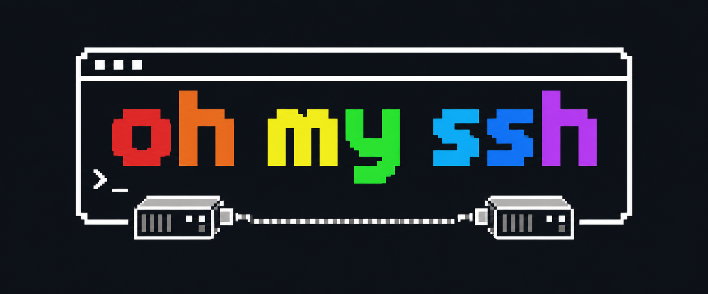

  

<h1 align="center">oh-my-ssh</h1>

  <strong>Your servers. Your connections. All in one place.</strong>

  A desktop app for organizing your servers and connection profiles.

  <code>C#</code> &nbsp;·&nbsp; <code>.NET 10</code> &nbsp;·&nbsp; <code>WPF</code> &nbsp;·&nbsp; <code>Windows</code>

  <a href="docs/architecture.md">Architecture</a> &nbsp;·&nbsp;
  <a href="LICENSE">Apache 2.0 License</a>

## Where does the name come from?

The name **oh-my-ssh** and the banner pay homage to **[Oh My Zsh](https://ohmyz.sh/)**.

## About the project

The project is under development.

## Interface languages

Choose **English**, **Português (Brasil)**, or **Español** in **Settings → Interface language**. Changes apply immediately to the open interface, including dialogs, transfer statuses, and the tray menu, and are remembered for the next launch. The initial language is Brazilian Portuguese.

Language preferences are stored separately from VPS profiles and credentials. Profile names, filenames, paths, and other user data remain unchanged. Windows-owned dialog controls may follow the operating system language. Documentation and diagnostic logs remain in English.

## SSH connections

Connect through the manual form or a saved VPS profile using password or private-key authentication. Encrypted private keys request the key file's password (passphrase) in the authentication dialog. Leave the key path empty to use the VPS password. The application verifies server fingerprints before accepting a connection and returns to the connection screen if the session drops.

Credentials remain separate from profile JSON. Saved profiles can optionally remember credentials in Windows Credential Manager; manual connections keep credentials temporary. Connection timeouts, cancellation, disconnection, and application shutdown release the SSH transport.

See [SSH setup and verification](docs/ssh-connections.md) for connection instructions, server trust, tested key formats, and local integration tests.

## SFTP files and transfers

Browse the connected server's directories, upload multiple selected or dropped files, and download one or more selected files. Use Ctrl or Shift to select remote files, or Ctrl+A to select the listing; a multi-file download asks for one destination folder. The remote panel supports parent navigation, entered paths, refresh, Unicode filenames, sizes, and modification dates. A serial transfer queue displays progress, transfer speed, and estimated remaining time. Pause upcoming work, cancel individual files or the whole queue, retry failed or canceled transfers, and clear successful entries.

Filter the queue by status and track pending files and remaining bytes. Each failed file includes a safe explanation and suggested action. Completed transfers provide shortcuts to the local folder, downloaded file, and remote path.

Local and remote files have distinct icons and colors by file category, with a generic fallback for unknown formats. Icons use filename hints and do not require opening files or downloading their contents.

Development files use dedicated icons for Python, Java, C#, Markdown, JavaScript, TypeScript, and other supported languages and tools. The bundled vector icons adapt to both themes and work offline; see [third-party notices](THIRD_PARTY_NOTICES.md) for attribution.

The file workspace gives transfers a resizable lower panel with an expand button. File names and progress receive flexible width, while speed and remaining time share a compact column. Activity and the interactive terminal are available in adjacent tabs.

Transfers use temporary files and safe finalization to preserve existing destinations on failure or cancellation. Replacements require confirmation; upload replacement also requires the server's atomic rename support. See [SFTP transfers](docs/sftp-transfers.md) for behavior, cancellation limits, and verification.

## Interactive terminal

Open a native WPF terminal on the authenticated VPS with a remote `xterm-256color` PTY. The terminal renders VT/ANSI state, including full-screen applications, alternate screens, cursor movement, UTF-8, wide characters, 256 colors, and true color. A bounded scrollback, selection, copy/paste, bracketed paste, and coalesced remote resizing support interactive work with Vim and tmux.

Shells open and reopen only through an explicit action. Closing or disconnecting clears the terminal and releases its channel; previous input is never replayed. See [terminal behavior and verification](docs/terminal.md) for keyboard shortcuts, limits, engine selection, and controlled tests using real Vim and tmux.

One VPS session is supported at a time. FTP/FTPS, persistent transfer history, recursive transfers, and automations are subsequent milestones.
